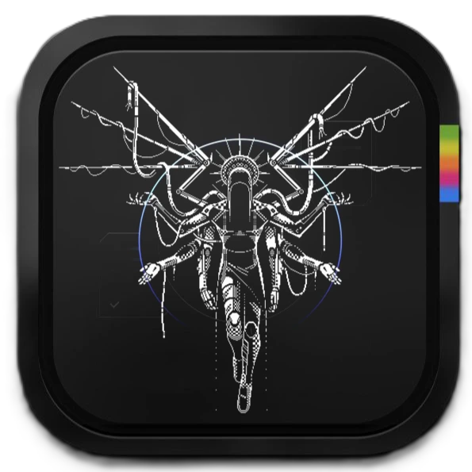

  

<h1 align="center">Admin12121</h1>

  
  
  

Admin12121 is the personal portfolio of a cybersecurity researcher and software developer focused on red teaming, reverse engineering, and offensive security. It features selected software projects, security tools, CTF achievements, research, and technical writing.